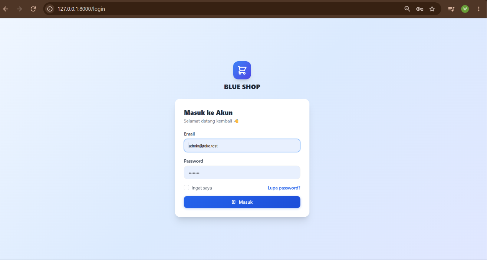
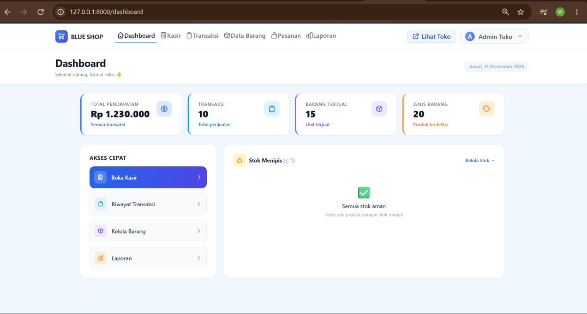
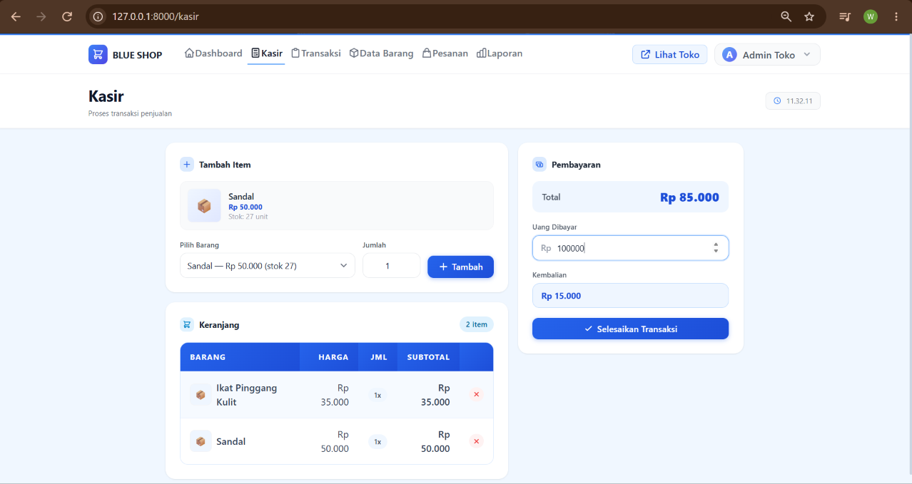
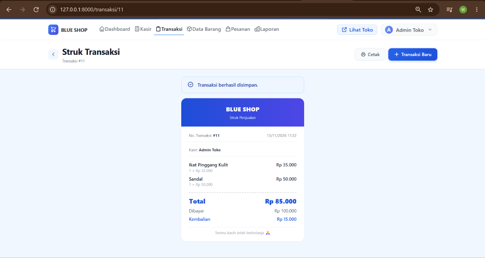
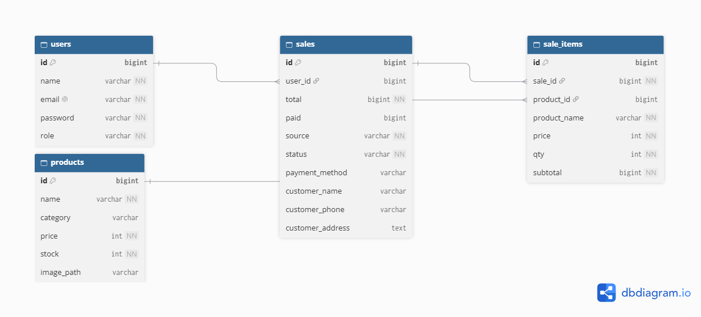

# Sistem Informasi Penjualan

Sistem Informasi Penjualan untuk toko **Blue Shop**, berbasis Laravel, untuk mengelola produk, transaksi kasir, pesanan online, laporan, dan pencetakan struk.

**Demo online:** https://blueshop.42web.io

## Fitur

- Login dengan 2 peran: **admin** dan **kasir**
- Manajemen produk (CRUD): nama, kategori, harga, stok, dan gambar
- Pencarian produk dan filter kategori, dilengkapi pagination
- Transaksi kasir dengan perhitungan total, jumlah dibayar, dan kembalian
- Toko online: keranjang, checkout, dan pesanan dengan data pelanggan (nama, telepon, alamat) serta metode pembayaran
- Struk transaksi yang bisa dicetak, untuk transaksi kasir maupun pesanan online
- Riwayat penjualan beserta detail item per transaksi
- Laporan penjualan dengan filter tanggal, dapat diunduh dalam format **PDF, Excel, dan CSV**
- Tampilan responsif, tombol login tersedia juga di HP

## Hak Akses

| Fitur | Admin | Kasir |
|-------|:-----:|:-----:|
| Kasir dan transaksi | ✅ | ✅ |
| Struk dan riwayat | ✅ | ✅ |
| Kelola produk (tambah, ubah, hapus) | ✅ | ❌ |
| Kelola pesanan online | ✅ | ❌ |
| Laporan dan unduh PDF/Excel/CSV | ✅ | ❌ |

## Akun Demo

| Peran | Email | Password |
|-------|-------|----------|
| Admin | `admin@blueshop.test` | `Admin12345` |
| Kasir | `kasir@blueshop.test` | `Admin12345` |

> Akun ini hanya untuk keperluan demo dan penilaian.

## Video Demo

Tonton demo aplikasi di sini: **ISI_LINK_VIDEO**

## Screenshot

### Login



### Dashboard



### Kasir



### Struk



## ERD



## Teknologi

- Laravel 12
- PHP 8.2
- MySQL
- Vite dan Tailwind CSS
- Node.js dan npm
- barryvdh/laravel-dompdf (ekspor PDF) dan maatwebsite/excel (ekspor Excel)

## Struktur Database

Tabel utama aplikasi:

| Tabel | Fungsi |
|-------|--------|
| `users` | Akun pengguna dan peran (`admin` atau `kasir`) |
| `products` | Data produk dan stok |
| `sales` | Data transaksi (kasir atau online) |
| `sale_items` | Rincian barang pada setiap transaksi |

Relasi: `users` memiliki banyak `sales`, `sales` memiliki banyak `sale_items`, dan `products` dapat muncul di banyak `sale_items`. Pada pesanan online, kolom `user_id` di `sales` dapat kosong karena tidak ada kasir yang menangani.

Tabel lain (`sessions`, `cache`, `jobs`, `migrations`, dan sebagainya) adalah tabel bawaan Laravel.

## Cara Instalasi

1. Clone repository

   ```bash
   git clone https://github.com/windadotcom/sistem-penjualan.git
   cd sistem-penjualan
   ```

2. Install dependensi

   ```bash
   composer install
   npm install
   ```

3. Siapkan file environment

   ```bash
   cp .env.example .env
   php artisan key:generate
   ```

   Di Windows (PowerShell), gunakan `copy .env.example .env`.

4. Buat database `sistem_penjualan` di MySQL (misalnya lewat phpMyAdmin), lalu sesuaikan `.env`:

   ```env
   DB_CONNECTION=mysql
   DB_HOST=127.0.0.1
   DB_PORT=3306
   DB_DATABASE=sistem_penjualan
   DB_USERNAME=root
   DB_PASSWORD=
   ```

5. Jalankan migrasi dan hubungkan folder storage

   ```bash
   php artisan migrate
   php artisan storage:link
   ```

6. Buat akun admin dan kasir. Jalankan SQL ini di phpMyAdmin (tab **SQL**, database `sistem_penjualan`). Password keduanya adalah `Admin12345`:

   ```sql
   INSERT INTO users (name, email, password, role, created_at, updated_at) VALUES
   ('Admin', 'admin@blueshop.test', '$2y$10$17WWa35J5SLXt3Evyg64x.4PPtn5xZKy2jOaxqserbdzv7T6XVqX2', 'admin', NOW(), NOW()),
   ('Kasir', 'kasir@blueshop.test', '$2y$10$17WWa35J5SLXt3Evyg64x.4PPtn5xZKy2jOaxqserbdzv7T6XVqX2', 'kasir', NOW(), NOW());
   ```

7. Jalankan aplikasi pada dua terminal

   ```bash
   php artisan serve
   ```

   ```bash
   npm run dev
   ```

8. Buka `http://127.0.0.1:8000` di browser, lalu login lewat tombol **Masuk** di pojok kanan atas.

## Catatan

- Gunakan satu alamat secara konsisten (`127.0.0.1` atau `localhost`) agar sesi login tidak error 419 (Page Expired).
- Jika tampilan tidak berubah setelah mengedit CSS, jalankan `npm run build` atau pastikan `npm run dev` sedang berjalan.
- Jangan commit file `.env` karena berisi kunci aplikasi dan kredensial database.

## Lisensi

Proyek ini dibuat untuk keperluan pembelajaran. Framework Laravel berlisensi [MIT](https://opensource.org/licenses/MIT).
